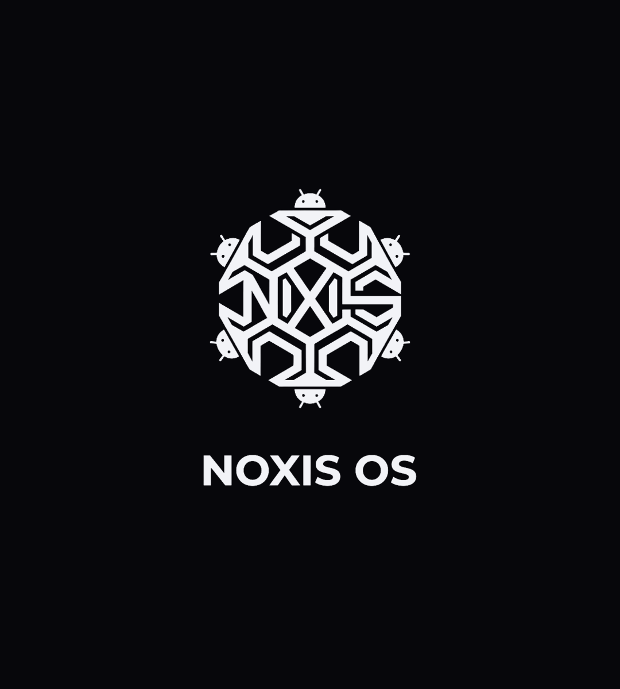

<p align="center">
  
</p>

<h1 align="center">Noxis OS</h1>

<p align="center">
  Hardened Android for the <b>Nothing Phone (3a) / (3a) Pro</b> (<code>asteroids</code>, Snapdragon 7s Gen 3 / SM7635)<br>
  LineageOS 24.0 base · GrapheneOS-style protections · KernelSU built into the kernel · no Google
</p>

<p align="center">
  <a href="LICENSE"></a>
  <a href="https://buymeacoffee.com/3rr0r303YT"></a>
  
  
</p>

> Sister project: **[Noxis Linux](https://github.com/Real3rr0r303YT/NoxisLinux)** – the same OPSEC idea as a real Debian/Phosh Linux distribution.

**Model:** unlocked bootloader + KernelSU in the kernel, root only for apps you allow one by one.
Everything works through Nothing's own vendor drivers: Wi-Fi, mobile network + VoLTE, Bluetooth, camera, fingerprint, NFC, eSIM, audio, Glyph.

| | Nothing OS | Noxis OS |
|---|---|---|
| System | Nothing's Android with its own apps | LineageOS/AOSP, built from source |
| Google | Play services built in | not included |
| Telemetry | Nothing + Google | none |
| Signing | Nothing's keys | **your own keys** |
| Root | none | KernelSU, per app |
| Network | default | Mullvad killswitch, Tor, per-app firewall |
| Kernel | Nothing's build | your build with hardening |

## Quick start

```bash
./noxis.sh check                    # RAM ≥ 32 GB (or 16 + 32 GB swap), ~300 GB free during the build
./noxis.sh sync                     # LineageOS 24.0 (--depth=1) + Noxis manifest + patches
./noxis.sh apps                     # camera, PDF, Firefox (Fennec), Mullvad, Tor, KernelSU manager
./noxis.sh blobs ~/Downloads/Asteroids-OTA.zip   # full Nothing OS OTA (B4.1-260928-1204)
./noxis.sh keys                     # your own signing keys → ~/.noxis-keys – BACK THEM UP
./noxis.sh build                    # user build
./noxis.sh sign                     # → ROM on the desktop, out/ is deleted
./noxis.sh flash                    # guided: fastboot + adb sideload
```

Full Nothing OS OTAs: <https://github.com/spike0en/nothing_archive>

### Disk space

| Phase | Used |
|---|---|
| Sources after `sync` (`--depth=1`) | ~110 GB |
| Peak during `build` (+ `out/` + 25 GB ccache) | ~280 GB |
| After `sign` (out/ and target_files deleted) | ~135 GB (sources + ccache) |

`NOXIS_KEEP_OUT=1` keeps `out/` (faster rebuilds), `NOXIS_CCACHE_SIZE=10G` shrinks the cache.

## Own apps (Nothing design)

The ROM ships 3rr0r's own open-source apps instead of the LineageOS defaults. The **[Noxis apps](.github/workflows/noxis-apps.yml)** GitHub Action builds them from source every Monday (or on demand) and publishes them as the rolling release `noxis-apps` with `SHA256SUMS` and the source commit of each APK. `./noxis.sh apps` downloads them, checks every checksum and bundles them; `./noxis.sh sign` re-signs them with your own keys.

| App in Noxis OS | Repository | Replaces |
|---|---|---|
| Calendar | [NothingCalendar](https://github.com/Real3rr0r303YT/NothingCalendar) | Etar |
| Clock (alarm, timer, stopwatch) | [NothingClock](https://github.com/Real3rr0r303YT/NothingClock) | DeskClock |
| Calculator | [Calculator](https://github.com/Real3rr0r303YT/Calculator) | ExactCalculator |
| Notes | [NothingNotes](https://github.com/Real3rr0r303YT/NothingNotes) | – (added) |
| Phone | [NothingCall](https://github.com/Real3rr0r303YT/NothingCall) | – (added; set it as default phone app – the stock dialer stays for emergency calls) |
| Battery | [NothingBattery](https://github.com/Real3rr0r303YT/NothingBattery) | – (added) |

## 1. Build manifest (`manifest/noxis.xml`)

| Path | Repo | Branch |
|---|---|---|
| Base | `LineageOS/android` | `lineage-24.0` |
| `device/nothing/asteroids` | `crdroid-asteroids/device_nothing_asteroids` | `17` |
| `kernel/nothing/sm7635` (incl. `KernelSU/`) | `crdroid-asteroids/kernel_nothing_sm7635` | `17` |
| `kernel/nothing/sm7635-modules` | `crdroid-asteroids/kernel_nothing_sm7635-modules` | `17` |
| `kernel/nothing/sm7635-devicetrees` | `crdroid-asteroids/kernel_nothing_sm7635-devicetrees` | `17` |
| `hardware/nothing`, `hardware/dolby` | `crdroid-asteroids/…` | `17` |
| `packages/apps/ParanoidGlyph`, `GlyphAdapter` | `crdroid-asteroids/…` (Glyph interface) | `17` |
| `packages/apps/OpenEUICC` + `prebuilts/openeuicc-deps` | `gitea.angry.im/PeterCxy` (eSIM without Google) | `master` |
| `vendor/nothing/asteroids` | **extracted from your OTA** (`./noxis.sh blobs`) | – |

## 2. Patches (`tools/noxis_patch.py`, idempotent)

| Patch | File | Effect |
|---|---|---|
| KernelSU built in | `device/.../BoardConfig.mk` | `TARGET_KERNEL_CONFIG += vendor/asteroids_ksu.config` (`CONFIG_KSU=y`) – added if missing |
| KernelSU source checked | `kernel/nothing/sm7635/KernelSU/kernel/Kbuild` | build stops if the driver is missing |
| Kernel hardening | `vendor/noxis/config/BoardConfigNoxis.mk` | `init_on_alloc=1 init_on_free=1 page_alloc.shuffle=1 slab_nomerge randomize_kstack_offset=on` |
| dm-verity on | `BoardConfigNoxis.mk` | system partitions stay read-only and verified (emergency: `NOXIS_DISABLE_VERITY=true`) |
| Noxis product | `lineage_asteroids.mk` | inherits `vendor/noxis/config/noxis.mk` |
| Nothing camera optional | `device.mk` | builds without the proprietary NTCamera app |
| Name | `vendor/lineage/config/version.mk` | "Noxis-1.0-DATE" in Settings |
| Browser | `vendor/lineage/config/common.mk` | Jelly out, Firefox (Fennec F-Droid, arm64) in |

## 3. KernelSU – root per app

KernelSU v3.3.1 (official `tiann/KernelSU`) is built into the device kernel, version `32703`.
The manager ships as the **officially signed** v3.3.1 – the kernel only accepts that signature.

```
KernelSU app → Superuser → tap an app → allow "Root"   (default: every app denied)
KernelSU app → Superuser → app → "Unmount modules" / profile "Restricted"
```

Pin another manager release: `NOXIS_KSU_TAG=v3.3.1 ./noxis.sh apps`.

## 4. Firewall matrix (LineageOS per-app network access)

Setting: *App info → Mobile data & Wi-Fi* – toggles **Network access**, **Wi-Fi**, **Mobile data**, **VPN**, **Background data**.

| App | Network | Wi-Fi | Mobile | VPN | Background | Root |
|---|:-:|:-:|:-:|:-:|:-:|:-:|
| Mullvad VPN | ✓ | ✓ | ✓ | – | ✓ | ✗ |
| Firefox (Fennec) | ✓ | ✓ | ✓ | ✓ | ✗ | ✗ |
| Tor Browser | ✓ | ✓ | ✓ | ✓ | ✗ | ✗ |
| GrapheneOS Camera | ✗ | ✗ | ✗ | ✗ | ✗ | ✗ |
| PDF Viewer | ✗ | ✗ | ✗ | ✗ | ✗ | ✗ |
| Gallery, Calculator, Clock, Notes, Calendar, Battery | ✗ | ✗ | ✗ | ✗ | ✗ | ✗ |
| NothingCall (phone) | system (cellular) | | | | | ✗ |
| Phone, SMS | system (cellular) | | | | | ✗ |
| KernelSU manager | ✗ | ✗ | ✗ | ✗ | ✗ | – |
| New apps | allow only when needed | | | | | ✗ |

## 5. Noxis Guard (system app, `vendor/noxis/packages/NoxisGuard`)

| Function | Default |
|---|---|
| Auto-reboot after X h locked (back to BFU) | 18 h |
| USB-C charge-only while locked | on |
| Wi-Fi / Bluetooth auto-off | off (2–120 min) |
| Mullvad always-on + killswitch | on (at first unlock) |
| Private DNS (DoT) | Quad9 (Mullvad, Cloudflare, off) |
| Google connectivity check | off |
| Random MAC per connection | on |
| Wi-Fi/BT scanning for location | off |
| Notification content on the lock screen | hidden |
| Time server | pool.ntp.org |

Quick settings: microphone and camera toggles are visible by default.

## 6. Deliberately not included

* **Sandboxed Google Play** – GrapheneOS' GmsCompat spans dozens of patches across `frameworks/base`, PackageManager, Settings and the GmsCompat app. Without that port there is no working "skeleton", and an empty one is not shipped.
* **Vanadium** – distributed for GrapheneOS only.
* **Mull** – DivestOS and Mull are discontinued (no security updates) → Fennec F-Droid.
* **Play Integrity / keystore spoofing** – not part of Noxis.
* **Locking the bootloader** – never do it; Noxis OS is designed for an unlocked bootloader. Relocking with a custom system can brick the phone.

## Before you flash

1. Settings → About phone → tap *Build number* 7× → Developer options → **OEM unlocking** + **USB debugging** on
2. `adb reboot bootloader` → `fastboot flashing unlock` (wipes all data) → confirm with the volume keys
3. `./noxis.sh flash` and follow the prompts

## Tests

```bash
./test/guard/run.sh                                          # 20 logic tests for Noxis Guard (JDK only)
./test/test_own_apps.sh                                      # 17 tests: own apps download, SHA-256, overrides
./test/test_flow.sh <device-tree> <lineage/config> <tf.zip>  # 36 flow tests for noxis.sh
python3 tools/gen_branding.py out/                            # logo, boot animation, wallpaper
```

## Support

If you like Noxis OS, you can support its development:

<a href="https://buymeacoffee.com/3rr0r303YT"></a>

## License

Noxis OS (the Noxis code in this repository) is free software under the **GNU General Public License v3.0** – see [LICENSE](LICENSE).

```
Noxis OS – Copyright (C) 2026 3rr0r (Real3rr0r303YT)
This program comes with ABSOLUTELY NO WARRANTY. This is free software, and you are
welcome to redistribute it under the conditions of the GNU GPL v3 or later.
```

Upstream components keep their licenses: LineageOS/AOSP (Apache-2.0), the Nothing/crDroid kernel (GPL-2.0), KernelSU (GPL-3.0), apps downloaded during the build (their own licenses).
Vendor blobs from the Nothing OTA are proprietary – they are extracted on your machine and never belong in this repository.
