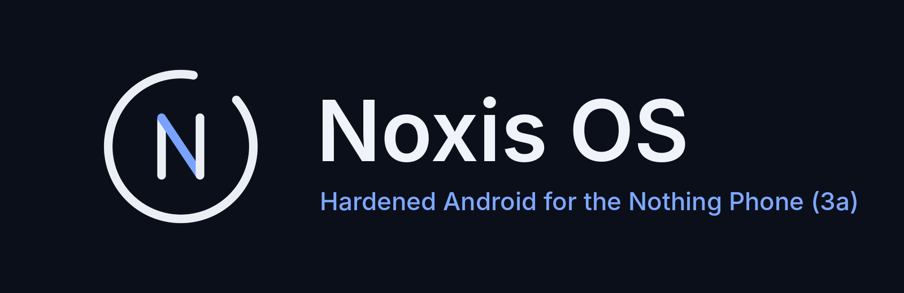

<p align="center">
  
</p>

<p align="center">
  Hardened Android for the <b>Nothing Phone (3a) / (3a) Pro</b> (<code>asteroids</code>, Snapdragon 7s Gen 3 / SM7635)<br>
  LineageOS 24.0 base · Android 17 · no root · offline virus scan · no Google
</p>

<p align="center">
  <a href="https://github.com/Real3rr0r303YT/NoxisOS/releases/latest"></a>
  <a href="LICENSE"></a>
  
  
  <a href="https://buymeacoffee.com/3rr0r303YT"></a>
</p>

<p align="center"><b>Made by 3rr0r303YT on TikTok</b> · free software under the GNU GPL v3</p>

> Sister project: **[Noxis Linux](https://github.com/Real3rr0r303YT/NoxisLinux)** – the same OPSEC idea as a real Debian/Phosh Linux distribution.

---

## What is Noxis OS?

Your phone, your rules. Noxis OS is built from source on LineageOS, signed with **your own keys** and ships without Google. It keeps Nothing's own vendor drivers, so the hardware works: Wi-Fi, mobile network + VoLTE, Bluetooth, camera, fingerprint, NFC, eSIM, audio and Glyph.

| | Nothing OS | Noxis OS |
|---|---|---|
| System | Nothing's Android with its own apps | LineageOS/AOSP, built from source |
| Google | Play services built in | not included – F-Droid + Aurora Store instead |
| Telemetry | Nothing + Google | none |
| Signing | Nothing's keys | **your own keys** |
| Root | none | **none** – OPSEC instead of root, verified boot with your own key |
| Network | default | Mullvad killswitch, Tor, per-app firewall |
| Malware | Google Play Protect | **Noxis Guard** – offline ClamAV signatures + trojan patterns |
| Updates | Nothing's servers | your GitHub releases, A/B with automatic rollback |

**Model:** no root, only OPSEC – no KernelSU, no su, no root modules. That is the way to verified boot and a bootloader locked with your own key (`./noxis.sh avb`).

### Why now: Android developer verification (2027)

Google is tying every Android app to a developer whose identity Google has verified – **also for apps from outside the Play Store** (F-Droid, GitHub, websites). It starts on 30 September 2026 in Brazil, Indonesia, Singapore and Thailand and goes global from 2027. On *certified* Android phones (the ones with Google services) an app from an unregistered developer then only installs through a long "advanced flow" with warnings, a restart and a 24-hour wait, or via ADB. F-Droid sees this as a threat to its existence, because it cannot make every upstream developer register with Google.

The check runs through Google Play services ("Android Developer Verifier"). **Noxis OS has no Google services and is not a certified device – so this check does not exist on Noxis.** F-Droid, IronFox, Termux and every APK you choose install like before.

Note: this is about *apps*, not the bootloader. Unlocking depends on the phone maker – Nothing still allows it on the Phone (3a). Unlock it now, while you can.

### Highlights

- **Noxis Guard** – security center: protection status, offline virus scan (new apps are checked at install), auto-reboot, USB lock, 2G block, VPN killswitch
- **Private browsing** – IronFox (Firefox with uBlock Origin preinstalled) as default browser, Tor Browser, Mullvad VPN
- **No Google, still apps** – F-Droid and Aurora Store (Play Store apps without an account) preinstalled, Termux after the first boot
- **Own apps in Nothing design** – calendar, clock, calculator, notes, phone, battery
- **No root** – nothing on the phone can change the system; verified boot + locked bootloader possible
- **Duress PIN** and **microG** (Google services as normal sandboxed apps, optional)
- **Fast like a flagship** – Settings, launcher, SystemUI and system_server compiled fully ahead of time, zram at 50 % of RAM (more apps stay open), 0.75x animations
- **OTA updates from GitHub** – Settings → System → System updates

---

## Download & install

What changed: [CHANGELOG.md](CHANGELOG.md)

Every release has everything you need: <https://github.com/Real3rr0r303YT/NoxisOS/releases/latest>

| File | What for |
|---|---|
| `Noxis-…-ota.zip` | update package – the phone's Updater installs it |
| `Noxis-…-img.zip.part0`, `.part1` | all partition images for a fresh install (split because GitHub allows 2 GiB per file) |
| `boot.img`, `init_boot.img`, `vendor_boot.img`, `recovery.img`, `dtbo.img`, `vbmeta*.img` | the small images on their own |
| `SHA256SUMS` | checksums of everything |

### Before you flash

1. **Do not update Nothing OS** – the firmware on the phone should match the Nothing OS version the blobs came from.
2. Settings → About phone → tap *Build number* 7× → Developer options → **OEM unlocking** + **USB debugging** on.
3. Back up everything – flashing wipes the phone.
4. `adb reboot bootloader` → `fastboot flashing unlock` → confirm with the volume keys.
5. **Never lock the bootloader again.** Noxis OS is made for an unlocked bootloader; relocking with a custom system can brick the phone.

### Fresh install

```bash
sha256sum -c SHA256SUMS --ignore-missing            # check the downloads
img=$(ls Noxis-*-img.zip.part0); img=${img%.part0}
cat "$img".part* > "$img"                           # put the image zip back together
git clone https://github.com/Real3rr0r303YT/NoxisOS && mkdir -p NoxisOS/release && mv "$img" NoxisOS/release/
cd NoxisOS && ./noxis.sh flash                      # guided, phone in fastboot mode
```

The first boot takes **5–15 minutes** (encryption setup, app optimisation). Then:

```bash
./noxis.sh postinstall    # USB debugging on – installs Termux, Tor Browser, Mullvad, IronFox, microG
```

### Updates

**Settings → System → System updates → Check for updates.** The Updater downloads the OTA from the GitHub release, checks it against the release key and installs it on the inactive slot. If the new system does not boot, the phone goes back to the old one by itself. Every OTA also carries the Nothing firmware (modem, bootloader, DSPs).

---

## Build it yourself

```bash
./noxis.sh check                    # RAM ≥ 32 GB (or 16 GB + swap), ~150–300 GB free
./noxis.sh sync                     # LineageOS 24.0 (--depth=1) + Noxis manifest + patches
./noxis.sh apps                     # own apps, IronFox, F-Droid, Aurora, Termux, Mullvad, Tor, microG, ClamAV signatures
./noxis.sh blobs ~/Downloads/Asteroids-OTA.zip   # full Nothing OS OTA (B4.1-260928-1204)
                                    #   other Nothing OS version / extracted dump: NOXIS_OTHER_FIRMWARE=1
./noxis.sh keys                     # your own signing keys → ~/.noxis-keys – BACK THEM UP
./noxis.sh build                    # user build (checks privileged permissions first), prints the time left every 5 min
./noxis.sh sign                     # → ROM in release/ and on the desktop, out/ stays for fast rebuilds
./noxis.sh flash                    # guided: boot images (both slots) → fastbootd → system partitions
./noxis.sh postinstall              # after the first boot
./noxis.sh publish                  # OTA + images → GitHub release, phone updates itself
```

| Helper | Use |
|---|---|
| `./noxis.sh eta` | time left of the running build (second terminal) |
| `./noxis.sh opsec` | check the built image against the OPSEC rules |

Keep the PC awake during the build (Hyprland): `pkill hypridle; ./noxis.sh build; hypridle & disown`

### Disk space

| Phase | Used |
|---|---|
| Sources after `sync` (`--depth=1`) | ~110 GB |
| Peak during `build` (+ `out/`) | ~250 GB |
| After `sign` | ~230 GB (`out/` kept) – `NOXIS_KEEP_OUT=0 ./noxis.sh cleanup` frees ~120 GB |

### Build variables

| Variable | Effect |
|---|---|
| `NOXIS_KEEP_OUT=0` | delete `out/` after signing (default: kept – the next build takes minutes instead of hours) |
| `NOXIS_JOBS=n` | parallel jobs (default: (RAM + swap/2) / 4 GB) |
| `NOXIS_DEBUG=1` | **debug build**: userdebug, ADB from the first boot without approval – boot-loop hunting only |
| `NOXIS_CCACHE=1` | turn ccache on (off by default, see Known issues) |
| `NOXIS_OTHER_FIRMWARE=1` | allow blobs from a different Nothing OS version than the device tree expects |
| `NOXIS_SRC=/path` | source tree on another disk |

### Publishing (`./noxis.sh publish`)

Uploads the newest signed OTA, the small images, the image zip (split below 2 GiB) and `SHA256SUMS` as a GitHub release, and writes [`ota/asteroids.json`](ota/) in the format of the LineageOS 24 Updater (a JSON array of builds with `files`, `os_sdk_level`, `ota_property_files`). Releases are tagged with version and date (`noxis-1.2-20261119`). Running it again for the same OTA completes the existing release instead of making a second one. Once the new release and the JSON are online, **older ROM releases are deleted** (the `noxis-apps` release stays); `NOXIS_KEEP_RELEASES=3` keeps the newest three, `NOXIS_KEEP_RELEASES=0` keeps all. Needs `gh auth login` once.

Full Nothing OS OTAs for the blobs: <https://github.com/spike0en/nothing_archive>

---

## Apps

### Own apps (Nothing design)

The apps are built into the image (the phone app as privileged app) – each with its home-screen widget.

Built from source by the **[Noxis apps](.github/workflows/noxis-apps.yml)** GitHub Action (every Monday or on demand) and published as the rolling release `noxis-apps` with `SHA256SUMS` and the source commit of each APK. `./noxis.sh apps` downloads them and checks every checksum; `./noxis.sh sign` re-signs them with your keys.

| App | Repository | Replaces |
|---|---|---|
| Calendar | [NothingCalendar](https://github.com/Real3rr0r303YT/NothingCalendar) | Etar |
| Clock (alarm, timer, stopwatch) | [NothingClock](https://github.com/Real3rr0r303YT/NothingClock) | DeskClock |
| Calculator | [Calculator](https://github.com/Real3rr0r303YT/Calculator) | ExactCalculator |
| Notes | [NothingNotes](https://github.com/Real3rr0r303YT/NothingNotes) | – (added) |
| Phone | [NothingCall](https://github.com/Real3rr0r303YT/NothingCall) | – (added as privileged app, so two-sided call recording works; set it as default phone app – the stock dialer stays for emergency calls) |
| Battery | [NothingBattery](https://github.com/Real3rr0r303YT/NothingBattery) | – (added) |
| Camera | [NothingCamera](https://github.com/Real3rr0r303YT/NothingCamera) | LineageOS camera (Aperture) – offline, metadata stripped, encrypted vault |

### Extra apps

| App | Source | How |
|---|---|---|
| **IronFox** (default browser) | [IronFox F-Droid repo](https://fdroid.ironfoxoss.org/fdroid/repo) | Firefox fork with **uBlock Origin preinstalled**, hardened settings, no telemetry |
| **F-Droid** | [f-droid.org](https://f-droid.org/packages/org.fdroid.fdroid/) | open-source app store – in the image |
| **Aurora Store** | [F-Droid](https://f-droid.org/packages/com.aurora.store/) | Play Store apps without a Google account (anonymous login) – in the image |
| **Mullvad VPN** | [mullvad.net](https://mullvad.net) | always-on + killswitch |
| **Tor Browser** | [torproject.org](https://www.torproject.org) | after the first boot (`postinstall`) |
| **Termux** | [F-Droid](https://f-droid.org/packages/com.termux/) | terminal with packages (`pkg install …`) – after the first boot, normal updatable app |
| GrapheneOS Camera + PDF Viewer | [GrapheneOS](https://github.com/GrapheneOS) | in the image, no network access |
| Your own APKs (e.g. ZArchiver) | you | put the `.apk` (arm64-v8a!) into `postinstall/` – `./noxis.sh postinstall` installs it too |

**Home screen:** LineageOS' launcher (Trebuchet) – clean, with icon packs, grid size, hidden apps and themed icons. Widgets of the own apps: long-press the home screen → *Widgets*.

Vendor-signed APKs with **compressed native libraries** (IronFox, Tor Browser, sometimes Mullvad) cannot be pre-installed system apps on Android 17 without breaking their signature. `./noxis.sh build` detects this, keeps them out of the image and puts them into `postinstall/` – `./noxis.sh postinstall` installs them as normal apps.

### Google services in the app sandbox (microG)

Noxis ships no Google code. If an app needs Google services (push notifications, maps, sign-in), `./noxis.sh postinstall` installs **microG** – the free re-implementation of Play services – from microG's official repo (SHA-256 checked against the repo index):

* `microG Services` (`com.google.android.gms`) and `microG Companion` (`com.android.vending`) are **normal user apps**: they run in the ordinary app sandbox without system privileges, get only the permissions you grant, and can be uninstalled at any time.
* This works because LineageOS 24 lets only apps signed with **microG's official key** pretend to have Google's signature – nothing else can.
* Then: open microG Settings → enable *Google device registration* and *Cloud Messaging* (push) as needed. Play Store apps come from **Aurora Store**.
* Difference to GrapheneOS' sandboxed Google Play: that runs Google's real Play services through GrapheneOS' own compatibility layer, which only GrapheneOS has. microG is a re-implementation – most apps work, but apps that require Play Integrity "strong" (some banking apps, Google Wallet) do not.
* Not wanted? `NOXIS_MICROG=0 ./noxis.sh apps` – or just uninstall both apps on the phone.

### Why are some apps not pre-installed?

Every app ends up on the phone in one of three ways:

| Way | Which apps | Updates |
|---|---|---|
| **In the image** (system app) | own Nothing apps, F-Droid, Aurora Store, GrapheneOS Camera + PDF Viewer, Noxis Guard – and Mullvad / IronFox when their APK allows it (see above) | come with every Noxis OTA, nothing to do |
| **After flashing** (`./noxis.sh postinstall`, normal app) | Termux, Tor Browser, microG, IronFox / Mullvad if the build moved them to `postinstall/`, your own APKs from `postinstall/` | update themselves (F-Droid, Tor's updater, …); they stay through Noxis OTAs |
| **You** | anything else – from F-Droid, Aurora Store or as APK | as usual |

Why not everything in the image:

- **Apps that update themselves** (Termux, Tor Browser) work best as normal apps. Baked into the image you would be stuck with the build's version until the next ROM update.
- **Signature:** vendor-signed APKs with compressed native libraries cannot be system apps on Android 17 without breaking their signature – the build moves them to `postinstall/` automatically.
- **Third-party and closed-source APKs** (e.g. ZArchiver) are not redistributed in this repository. Put them into `postinstall/` yourself.
- **No Google apps** on purpose: Google Play services and the Play Store are proprietary and phone home – Aurora Store gives you Play Store apps without them.

**After an OTA:** apps in the image are updated with the system. Apps from `postinstall` stay installed. If a new Noxis version adds a new post-install app, connect the phone once and run `./noxis.sh postinstall` again – apps that are already installed are just updated.

---

## Security

### Noxis Guard (`vendor/noxis/packages/NoxisGuard`)

The security center of Noxis OS – **Settings → Noxis Guard** or the app icon.

* **Protection status** – reads the real system state and shows e.g. *7 of 8 protections active*, with a hint for every missing one.
* **Virus scan** – checks every user app against ClamAV's Android malware signatures (MD5/SHA-1/SHA-256 of the APK) and for trojan patterns: active accessibility service, device admin, notification access, SMS + overlay (banking trojans), overlay + app install (droppers), installed outside F-Droid/Aurora. **New apps are checked at install** and a hit shows a notification. Fully offline: `./noxis.sh apps` fetches the ClamAV databases on the PC, keeps only the Android signatures and puts them into the image as sorted index files (`/product/etc/noxis/av`) that Guard binary-searches – no RAM cost. Signatures update with every Noxis build. Limit: hashes only find *known* samples; the patterns catch new ones; nothing finds everything.
* **Duress PIN** (like GrapheneOS) – a second PIN / password; entered on the lock screen it **factory-resets the phone** instead of unlocking. Set in Guard → *Gerätesperre → Notfall-PIN* (needs your current PIN). Only a salted PBKDF2 hash is stored, in `locksettings.db` (system only). Safety: it can never equal your real PIN – Guard refuses that, and changing your lock to the duress PIN or removing the lock deletes it. Any error inside the check means "no match", so a bug can never lock you out. Frameworks patch: `p_duress` (`NoxisDuress.java` + two calls in `LockSettingsService`).
* **Shortcuts** – per-app network access, default apps, system updates, Mullvad.

| Function | Default |
|---|---|
| Auto-reboot after X h locked (back to BFU) | 18 h |
| Duress PIN (wipes the phone) | off |
| USB-C charge-only while locked | on |
| Wi-Fi / Bluetooth auto-off | off (2–120 min) |
| Mullvad always-on + killswitch | on (at first unlock) |
| Private DNS (DoT) | Quad9 (Mullvad, Cloudflare, off) |
| Google connectivity check | off |
| Random MAC per connection | on |
| 2G (GSM/EDGE/CDMA) – used by IMSI catchers | **blocked** (switch "Allow 2G"; emergency calls always work) |
| Wi-Fi/BT scanning for location | off |
| Notification content on the lock screen | hidden |
| Time server | pool.ntp.org |

### Firewall (LineageOS per-app network access)

*App info → Mobile data & Wi-Fi* – toggles **Network access**, **Wi-Fi**, **Mobile data**, **VPN**, **Background data**.

| App | Network | Wi-Fi | Mobile | VPN | Background | Root |
|---|:-:|:-:|:-:|:-:|:-:|:-:|
| Mullvad VPN | ✓ | ✓ | ✓ | – | ✓ | ✗ |
| IronFox, Tor Browser | ✓ | ✓ | ✓ | ✓ | ✗ | ✗ |
| F-Droid, Aurora Store | ✓ | ✓ | ✓ | ✓ | ✗ | ✗ |
| Termux | ✓ | ✓ | ✓ | ✓ | ✗ | ✗ |
| Camera, PDF Viewer, Gallery | ✗ | ✗ | ✗ | ✗ | ✗ | ✗ |
| Calculator, Clock, Notes, Calendar, Battery | ✗ | ✗ | ✗ | ✗ | ✗ | ✗ |
| Phone, SMS, NothingCall | system (cellular) | | | | | ✗ |
| New apps | allow only when needed | | | | | ✗ |

### Deliberately not included

* **Sandboxed Google Play** – GrapheneOS' GmsCompat spans dozens of patches across `frameworks/base`, PackageManager, Settings and its own app. Without that port there is no working "skeleton", and an empty one is not shipped.
* **Vanadium** – distributed for GrapheneOS only. IronFox is the hardened browser here.
* **Play Integrity / keystore spoofing** – not part of Noxis.
* **Root (KernelSU, Magisk)** – root tools can change the system and break verified boot; Noxis is OPSEC without root.
* **Samsung's One UI launcher** – proprietary.

---

## Under the hood

### Build manifest (`manifest/noxis.xml`)

| Path | Repo | Branch |
|---|---|---|
| Base | `LineageOS/android` | `lineage-24.0` |
| `device/nothing/asteroids` | `crdroid-asteroids/device_nothing_asteroids` | `17` |
| `kernel/nothing/sm7635` | `crdroid-asteroids/kernel_nothing_sm7635` | `17` |
| `kernel/nothing/sm7635-modules` | `crdroid-asteroids/kernel_nothing_sm7635-modules` | `17` |
| `kernel/nothing/sm7635-devicetrees` | `crdroid-asteroids/kernel_nothing_sm7635-devicetrees` | `17` |
| `hardware/nothing`, `hardware/dolby` | `crdroid-asteroids/…` | `17` |
| `packages/apps/ParanoidGlyph`, `GlyphAdapter` | `crdroid-asteroids/…` (Glyph interface) | `17` |
| `packages/apps/OpenEUICC` + `prebuilts/openeuicc-deps` | `gitea.angry.im/PeterCxy` (eSIM without Google) | `master` |
| `vendor/nothing/asteroids` | **extracted from your OTA** (`./noxis.sh blobs`) | – |

### Patches and overlays (`tools/noxis_patch.py`, idempotent)

| Change | Where | Effect |
|---|---|---|
| No root | `device/.../BoardConfig.mk` | the device tree's KernelSU config is removed from the kernel |
| Kernel hardening | `vendor/noxis/config/BoardConfigNoxis.mk` | `init_on_alloc=1 init_on_free=1 page_alloc.shuffle=1 slab_nomerge randomize_kstack_offset=on` |
| Noxis product | `lineage_asteroids.mk` | inherits `vendor/noxis/config/noxis.mk` |
| Nothing camera optional | `device.mk` | builds without the proprietary NTCamera app |
| Name | `vendor/lineage/config/version.mk` | "Noxis-1.4-DATE" in Settings (number from `NOXIS_VERSION` in `noxis.mk`) |
| Setup wizard | `NoxisSetupWizardOverlay` | "Welcome to NoxisOS" with the Noxis logo |
| About phone | `version.mk` + `NoxisLineageSdkOverlay` | "NoxisOS version" instead of "LineageOS version" |
| System updates | `NoxisUpdaterOverlay` | NoxisOS name, Noxis mark and colours on the updater card, links to GitHub |
| Browser | `vendor/lineage/config/common.mk` | Jelly out, IronFox as default browser |
| Setup wizard | `NoxisSetupWizardOverlay` | "Welcome to NoxisOS", Noxis mark in the welcome animation (`raw/lottie_welcome`, made by `tools/gen_setup_lottie.py`) and on the finish screen |
| Recovery + fastbootd | `bootable/recovery` | Noxis logos (blue recovery, red fastbootd), Noxis menu colours and "NoxisOS 1.4 (DATE)" instead of LineageOS logos and "Version 24.0" |
| zram | `device/nothing/asteroids/init/fstab.zram.2g` | 50 % of RAM instead of a fixed 2 GB |
| Easter egg | `LineageParts` `PlatLogoActivity` | tap the NoxisOS version: Noxis dot-matrix egg – waves on every touch, a message after 7 taps, long press for the credit |
| Restart with cable | `vendor/noxis/config/init/noxis-charger.rc` | boots Android instead of the black charging screen after a restart |

---

## Flashing in detail (`./noxis.sh flash`)

Everything is written directly with fastboot – no OTA via `adb sideload` for the first install:

| Step | What happens |
|---|---|
| 1 | Checks the phone: fastboot, unlocked, `asteroids` (the bootloader reports the Qualcomm name **`pineapple`** – that is correct) |
| 2 | `fastboot --set-active=a`, then `boot`, `init_boot`, `vendor_boot`, `recovery`, `dtbo`, `vbmeta*` into **both slots**. The Nothing bootloader reports no `has-slot`, so the suffix is set explicitly |
| 3 | `vbmeta` with `--disable-verity --disable-verification` (see Known issues) |
| 4 | Reboots into **fastbootd** (userspace fastboot in the Noxis recovery) |
| 5 | Drops a pending update snapshot, deletes the other slot's logical partitions and `*-cow` leftovers, flashes `system`, `system_ext`, `product`, `vendor`, `odm`, `system_dlkm`, `vendor_dlkm` into slot a |
| 6 | `fastboot -w` (wipe data) and reboot |

**Why not `adb sideload` for the first install?** An OTA from the recovery goes into the *other* slot as a virtual A/B snapshot. If that slot does not boot a few times, the bootloader marks it `slot-unbootable` and silently switches back to the old slot – which still has Nothing OS' system with the Noxis kernel. Written directly, slot a is complete. Later updates through the Updater are fine.

Stuck for more than 15 minutes: hold **Volume down + Power** for 15 s → fastboot. Going back to Nothing OS always works.

### Repair and debugging without a rebuild

| Command | Use |
|---|---|
| `./noxis.sh debugadb` | puts your PC's ADB key into `init_boot`/`recovery` and turns ADB on during boot – `adb logcat` while the boot hangs |
| `./noxis.sh sysextfix` | adds missing privileged permissions to `system_ext.img` of the finished build |
| `./noxis.sh direct` | writes only the system partitions again via fastbootd |
| `fastboot getvar slot-unbootable:b` | shows whether the bootloader gave up on a slot |

---

## Locking the bootloader (`./noxis.sh avb`)

Each step checks the one before it, and everything up to `lock` can be undone while the bootloader is unlocked:

| Step | What happens |
|---|---|
| `./noxis.sh avb test` | vbmeta of the **current slot** re-signed with your AVB key and verification **on** (same descriptors, nothing rebuilt). If Android does not boot, the phone falls back to the other slot. |
| `./noxis.sh avb status` | Shows `verifiedbootstate`, `veritymode`, OEM unlocking. `veritymode=enforcing` = verified boot works. |
| `./noxis.sh avb log` | Kernel/init log of a failed boot (pstore) – to find why verification fails. |
| `./noxis.sh avb restore` | Back to vbmeta with verification off. |
| `./noxis.sh avb key` | Writes your AVB public key into the bootloader (`fastboot flash avb_custom_key`), safe while unlocked. On the Nothing Phone (3a) run it **before** `avb test`: the bootloader may pass the vbmeta info to Android only for a trusted key. Stops if the bootloader refuses it – then locking is impossible on this phone. |
| `./noxis.sh avb unkey` | Erases `avb_custom_key` again (only while unlocked). |
| `./noxis.sh avb lock` | Only if verified boot was confirmed, the key matches, OEM unlocking is on and the phone has **no root** (no KernelSU, no su): type `LOCK` → `fastboot flashing lock` (**wipes the phone**). From then on every `sign` builds with verified boot on. |

**Nothing Phone (3a), tested on 1.4/1.5:** while unlocked, Nothing's bootloader passes no vbmeta info to Android, and with verification ON (`avb test`) it refuses to start Noxis at all – the slot is marked unbootable on the first try, the kernel never starts. The ROM itself is consistent: `avbtool verify_image` passes for vbmeta, the chains (boot, recovery, vbmeta_system, vbmeta_vendor) and dtbo/init_boot/vendor_boot, the bootloader accepts `avb_custom_key`, and the rollback index (security patch 2026-11-01) is newer than the firmware's (2026-04-05). Nothing phones are reported to boot custom-key builds once **locked** (avbroot device list), so on this phone `avb test` cannot prove anything – locking is the only test: `NOXIS_AVB_UNTESTED=1 ./noxis.sh avb lock`. If it does not boot locked: `fastboot flashing unlock` (wipes) and `./noxis.sh flash`.

Keep **OEM unlocking** on after locking – it is the way back (`fastboot flashing unlock`). Never lose `~/.noxis-keys`: without `avb.pem` no update boots on a locked phone.

## Known issues

* **Verified boot is switched off by default.** With verification on, `init` aborted during boot on early builds. `vbmeta` is flashed with `--disable-verity --disable-verification`, and `./noxis.sh sign` builds the vbmeta inside the OTA the same way (`--flags 3`), so updates boot too. The images are still signed with your own keys. Do **not** run `fastboot flashing lock` by hand – use the guarded path below.
* **Restart with the USB cable plugged in** used to end in the black charging screen. `noxis-charger.rc` leaves charger mode once after a restart; if the bootloader insists, the phone stays charging – press power.
* **Missing privileged permissions = boot loop.** `./noxis.sh build` compares every privileged permission of our priv-apps with `vendor/noxis/permissions/*.xml` **before** building.
* **Firmware/blob version:** the device tree expects Nothing OS B4.1-260928-1204. Blobs from another version build with `NOXIS_OTHER_FIRMWARE=1`, but camera, modem or fingerprint may misbehave.
* **Little RAM:** the Soong analysis needs 15–20 GB. With less than 32 GB RAM `./noxis.sh build` sets up 20 GB of compressed swap (zram).
* **ccache** is off by default (`ccache: error: Not a directory` inside the Android 17 build sandbox).
* **Git LFS:** without `git-lfs` only pointers arrive for the WebView prebuilts; `sync` requires it and `build` fetches missing LFS files itself.
* **32-bit APKs** (`armeabi-v7a` only) do not install – the phone is 64-bit only. Take the `arm64-v8a` or universal build.

## Tests

```bash
./test/guard/run.sh                                          # logic tests for Noxis Guard (JDK only)
./test/test_own_apps.sh                                      # own apps: download, SHA-256, overrides
./test/test_publish.sh                                       # OTA publishing, release images, Updater JSON
./test/test_flow.sh <device-tree> <lineage/config> <tf.zip>  # flow tests for noxis.sh
```

## Support

If you like Noxis OS, you can support its development:

<a href="https://buymeacoffee.com/3rr0r303YT"></a>

## License

Noxis OS (the Noxis code in this repository) is free software under the **GNU General Public License v3.0** – see [LICENSE](LICENSE).

```
Noxis OS – Copyright (C) 2026 3rr0r (Real3rr0r303YT) – Made by 3rr0r303YT on TikTok
This program comes with ABSOLUTELY NO WARRANTY. This is free software, and you are
welcome to redistribute it under the conditions of the GNU GPL v3 or later.
```

Upstream components keep their licenses: LineageOS/AOSP (Apache-2.0), the Nothing/crDroid kernel (GPL-2.0), apps downloaded during the build (their own licenses). Vendor blobs from the Nothing OTA are proprietary – they are extracted on your machine and never belong in this repository.
