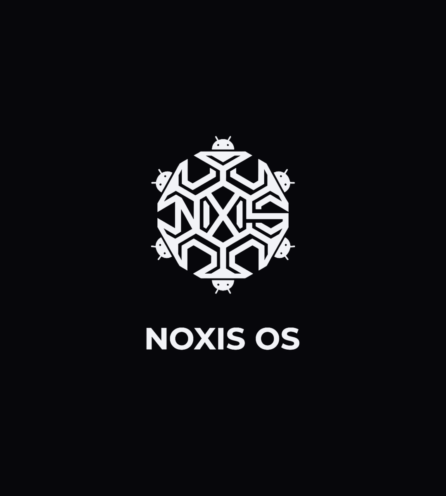

<p align="center">
  
</p>

<h1 align="center">Noxis OS</h1>

<p align="center">
  Hardened Android for the <b>Nothing Phone (3a) / (3a) Pro</b> (<code>asteroids</code>, Snapdragon 7s Gen 3 / SM7635)<br>
  LineageOS 24.0 base · GrapheneOS-style protections · KernelSU built into the kernel · no Google
</p>

<p align="center">
  <a href="LICENSE"></a>
  <a href="https://buymeacoffee.com/3rr0r303YT"></a>
  
  
</p>

> Sister project: **[Noxis Linux](https://github.com/Real3rr0r303YT/NoxisLinux)** – the same OPSEC idea as a real Debian/Phosh Linux distribution.

**Model:** unlocked bootloader + KernelSU in the kernel, root only for apps you allow one by one.
Everything works through Nothing's own vendor drivers: Wi-Fi, mobile network + VoLTE, Bluetooth, camera, fingerprint, NFC, eSIM, audio, Glyph.

| | Nothing OS | Noxis OS |
|---|---|---|
| System | Nothing's Android with its own apps | LineageOS/AOSP, built from source |
| Google | Play services built in | not included |
| Telemetry | Nothing + Google | none |
| Signing | Nothing's keys | **your own keys** |
| Root | none | KernelSU, per app |
| Network | default | Mullvad killswitch, Tor, per-app firewall |
| Kernel | Nothing's build | your build with hardening |

## Quick start

```bash
./noxis.sh check                    # RAM ≥ 32 GB (or 16 + 32 GB swap), ~300 GB free during the build
./noxis.sh sync                     # LineageOS 24.0 (--depth=1) + Noxis manifest + patches
./noxis.sh apps                     # own apps, IronFox, F-Droid, Aurora, Termux, Mullvad, Tor, KernelSU, ClamAV signatures, KSU modules
./noxis.sh blobs ~/Downloads/Asteroids-OTA.zip   # full Nothing OS OTA (B4.1-260928-1204)
                                    #   other Nothing OS version / extracted dump: NOXIS_OTHER_FIRMWARE=1
./noxis.sh keys                     # your own signing keys → ~/.noxis-keys – BACK THEM UP
./noxis.sh build                    # user build (checks privileged permissions first)
./noxis.sh eta                      # (2nd terminal) time left of the running build – build prints it every 5 min too
./noxis.sh sign                     # → ROM on the desktop, out/ stays for fast rebuilds (NOXIS_KEEP_OUT=0 deletes it)
./noxis.sh flash                    # guided: boot images (both slots) → fastbootd → system partitions
./noxis.sh postinstall              # after first boot: Termux, Tor Browser … via adb (see below)
./noxis.sh publish                  # signed OTA → GitHub release → phone updates itself
```

### Updates from GitHub (Settings → System → Updater)

`./noxis.sh publish` uploads the newest signed OTA as a release of this repository and writes [`ota/asteroids.json`](ota/). The phone's **Updater** (Settings → System → Updater) reads that file, downloads the OTA from the release, verifies it against **your** release key and installs it on the inactive slot (A/B, automatic rollback if it fails to boot). Every OTA contains the system and the Nothing firmware (modem, bootloader, DSPs), so firmware updates arrive the same way. Needs `gh auth login` once; GitHub allows up to 2 GiB per file.

Full Nothing OS OTAs: <https://github.com/spike0en/nothing_archive>

### Disk space

| Phase | Used |
|---|---|
| Sources after `sync` (`--depth=1`) | ~110 GB |
| Peak during `build` (+ `out/`) | ~250 GB |
| After `sign` (out/ and target_files deleted) | ~110 GB |

`out/` is kept by default – the next build then takes minutes instead of hours. `NOXIS_KEEP_OUT=0` deletes it to free ~120 GB.

### Build environment

| Variable | Effect |
|---|---|
| `NOXIS_KEEP_OUT=0` | delete `out/` after signing (default: kept for fast rebuilds) |
| `NOXIS_JOBS=n` | number of parallel jobs (default: (RAM + swap/2) / 4 GB) |
| `NOXIS_DEBUG=1` | **debug build**: userdebug, ADB from the first boot without approval – for boot-loop hunting only |
| `NOXIS_CCACHE=1` | turn ccache on (off by default, see Known issues) |
| `NOXIS_OTHER_FIRMWARE=1` | allow blobs from a different Nothing OS version than the device tree expects |
| `NOXIS_SRC=/path` | source tree on another disk |

## Own apps (Nothing design)

The ROM ships 3rr0r's own open-source apps instead of the LineageOS defaults. The **[Noxis apps](.github/workflows/noxis-apps.yml)** GitHub Action builds them from source every Monday (or on demand) and publishes them as the rolling release `noxis-apps` with `SHA256SUMS` and the source commit of each APK. `./noxis.sh apps` downloads them, checks every checksum and bundles them; `./noxis.sh sign` re-signs them with your own keys.

| App in Noxis OS | Repository | Replaces |
|---|---|---|
| Calendar | [NothingCalendar](https://github.com/Real3rr0r303YT/NothingCalendar) | Etar |
| Clock (alarm, timer, stopwatch) | [NothingClock](https://github.com/Real3rr0r303YT/NothingClock) | DeskClock |
| Calculator | [Calculator](https://github.com/Real3rr0r303YT/Calculator) | ExactCalculator |
| Notes | [NothingNotes](https://github.com/Real3rr0r303YT/NothingNotes) | – (added) |
| Phone | [NothingCall](https://github.com/Real3rr0r303YT/NothingCall) | – (added; set it as default phone app – the stock dialer stays for emergency calls) |
| Battery | [NothingBattery](https://github.com/Real3rr0r303YT/NothingBattery) | – (added) |

**Home screen:** LineageOS' own launcher (Trebuchet) – clean, with icon packs, grid size, hidden apps and themed icons.
Want the One UI look? Install a One UI Home module in the KernelSU app yourself (e.g. [reiryuki/One-UI-Home-35-Magisk-Module](https://github.com/reiryuki/One-UI-Home-35-Magisk-Module)). Samsung's launcher is proprietary, so Noxis does not ship it, and those modules are made for older Android versions – on Android 17 it may not start.

| Extra app | Source | How |
|---|---|---|
| **IronFox** (default browser) | [IronFox F-Droid repo](https://fdroid.ironfoxoss.org/fdroid/repo) | Firefox fork with **uBlock Origin preinstalled**, hardened settings, no telemetry – in the image |
| **F-Droid** | [f-droid.org](https://f-droid.org/packages/org.fdroid.fdroid/) | open-source app store – in the image |
| **Aurora Store** | [F-Droid](https://f-droid.org/packages/com.aurora.store/) | Play Store apps without a Google account (anonymous login) – in the image |
| Your own extra APKs (e.g. ZArchiver) | you | put the `.apk` into `~/NoxisOS/postinstall/` – `./noxis.sh postinstall` installs it too |
| **Termux** | [F-Droid](https://f-droid.org/packages/com.termux/) | terminal with packages (`pkg install …`) – installed by `./noxis.sh postinstall` as a normal, updatable app |

## 1. Build manifest (`manifest/noxis.xml`)

| Path | Repo | Branch |
|---|---|---|
| Base | `LineageOS/android` | `lineage-24.0` |
| `device/nothing/asteroids` | `crdroid-asteroids/device_nothing_asteroids` | `17` |
| `kernel/nothing/sm7635` (incl. `KernelSU/`) | `crdroid-asteroids/kernel_nothing_sm7635` | `17` |
| `kernel/nothing/sm7635-modules` | `crdroid-asteroids/kernel_nothing_sm7635-modules` | `17` |
| `kernel/nothing/sm7635-devicetrees` | `crdroid-asteroids/kernel_nothing_sm7635-devicetrees` | `17` |
| `hardware/nothing`, `hardware/dolby` | `crdroid-asteroids/…` | `17` |
| `packages/apps/ParanoidGlyph`, `GlyphAdapter` | `crdroid-asteroids/…` (Glyph interface) | `17` |
| `packages/apps/OpenEUICC` + `prebuilts/openeuicc-deps` | `gitea.angry.im/PeterCxy` (eSIM without Google) | `master` |
| `vendor/nothing/asteroids` | **extracted from your OTA** (`./noxis.sh blobs`) | – |

## 2. Patches (`tools/noxis_patch.py`, idempotent)

| Patch | File | Effect |
|---|---|---|
| KernelSU built in | `device/.../BoardConfig.mk` | `TARGET_KERNEL_CONFIG += vendor/asteroids_ksu.config` (`CONFIG_KSU=y`) – added if missing |
| KernelSU source checked | `kernel/nothing/sm7635/KernelSU/kernel/Kbuild` | build stops if the driver is missing |
| Kernel hardening | `vendor/noxis/config/BoardConfigNoxis.mk` | `init_on_alloc=1 init_on_free=1 page_alloc.shuffle=1 slab_nomerge randomize_kstack_offset=on` |
| dm-verity on | `BoardConfigNoxis.mk` | system partitions stay read-only and verified (emergency: `NOXIS_DISABLE_VERITY=true`) – **currently switched off at flash time, see [Known issues](#known-issues)** |
| Noxis product | `lineage_asteroids.mk` | inherits `vendor/noxis/config/noxis.mk` |
| Nothing camera optional | `device.mk` | builds without the proprietary NTCamera app |
| Name | `vendor/lineage/config/version.mk` | "Noxis-1.0-DATE" in Settings |
| Setup wizard | `NoxisSetupWizardOverlay` | "Welcome to NoxisOS" with the Noxis logo instead of LineageOS |
| About phone | `version.mk` + `NoxisLineageSdkOverlay` | "NoxisOS version: Noxis-1.0-DATE-asteroids" instead of "LineageOS version: 24.0-…-UNOFFICIAL" |
| System updates | `NoxisUpdaterOverlay` | "NoxisOS" instead of "LineageOS 24.0" in the Updater |
| Browser | `vendor/lineage/config/common.mk` | Jelly out; **IronFox** (hardened Firefox with uBlock Origin) is the default browser |

## 3. KernelSU – root per app

KernelSU (official `tiann/KernelSU`) is built into the device kernel. The kernel tree from crDroid brings its own, often unreleased copy – `./noxis.sh build` replaces it with the **official release `v3.3.1`** (`NOXIS_KSU_PIN`), and `./noxis.sh apps` bundles the **officially signed** manager of exactly that release. Kernel and manager then speak the same interface version (UAPI); otherwise the app shows *Manager update required* or *Kernel update required*. `NOXIS_KSU_PIN=none` keeps the kernel tree's copy, and the manager is then picked by its UAPI version (the official main-branch build if the kernel is newer than every release).

```
KernelSU app → Superuser → tap an app → allow "Root"   (default: every app denied)
KernelSU app → Superuser → app → "Unmount modules" / profile "Restricted"
```

Just the manager, installed straight onto the connected phone: `./noxis.sh ksu` (for a kernel built with `NOXIS_KSU_PIN=none`: `NOXIS_KSU_PIN=none ./noxis.sh ksu`).

### KernelSU modules (`ksu-modules/`)

`./noxis.sh apps` zips every folder in `ksu-modules/` into `postinstall/modules/`, `./noxis.sh postinstall` pushes it to *Download* and installs it with `ksud` (allow **Shell** once in KernelSU → Superuser, or install it by hand: KernelSU → Modules → Install → Download/…zip).

* **NoxisSpoof** – apps see another phone model through `android.os.Build` (brand, manufacturer, model of system/product/system_ext). Profiles: Galaxy A55 (default), Galaxy S24, Pixel 8, Pixel 7a, **Off** (real Nothing Phone (3a)) – **Action** button in KernelSU's module list switches, then reboot. vendor/odm values stay real so camera, modem and sensors keep working. Honest limit: it hides the model from simple apps and sites, not from apps that fingerprint hardware, kernel or Play Integrity.

## 4. Firewall matrix (LineageOS per-app network access)

Setting: *App info → Mobile data & Wi-Fi* – toggles **Network access**, **Wi-Fi**, **Mobile data**, **VPN**, **Background data**.

| App | Network | Wi-Fi | Mobile | VPN | Background | Root |
|---|:-:|:-:|:-:|:-:|:-:|:-:|
| Mullvad VPN | ✓ | ✓ | ✓ | – | ✓ | ✗ |
| IronFox (default browser) | ✓ | ✓ | ✓ | ✓ | ✗ | ✗ |
| Tor Browser | ✓ | ✓ | ✓ | ✓ | ✗ | ✗ |
| F-Droid, Aurora Store | ✓ | ✓ | ✓ | ✓ | ✗ | ✗ |
| Termux | ✓ | ✓ | ✓ | ✓ | ✗ | only if you allow it |
| GrapheneOS Camera | ✗ | ✗ | ✗ | ✗ | ✗ | ✗ |
| PDF Viewer | ✗ | ✗ | ✗ | ✗ | ✗ | ✗ |
| Gallery, Calculator, Clock, Notes, Calendar, Battery | ✗ | ✗ | ✗ | ✗ | ✗ | ✗ |
| NothingCall (phone) | system (cellular) | | | | | ✗ |
| Phone, SMS | system (cellular) | | | | | ✗ |
| KernelSU manager | ✗ | ✗ | ✗ | ✗ | ✗ | – |
| New apps | allow only when needed | | | | | ✗ |

## 5. Noxis Guard (system app, `vendor/noxis/packages/NoxisGuard`)

The security center of Noxis OS – **Settings → Noxis Guard** (top of the settings) or the app icon.

* **Protection status** – reads the real system state and shows e.g. *7 of 8 protections active*, with a hint for every missing one (killswitch, encrypted DNS, 2G off, USB lock, auto-reboot, no Google connectivity check, random MAC, hidden lock-screen notifications)
* **Virus scan** – checks every user app against ClamAV's Android malware signatures (MD5/SHA-1/SHA-256 of the APK) and for trojan patterns: active accessibility service, device admin, notification access, SMS + overlay (banking trojans), overlay + app install (droppers), installed outside F-Droid/Aurora. **New apps are checked right at install** and a hit shows a notification. Fully offline: `./noxis.sh apps` fetches the ClamAV databases on the PC, keeps only Android signatures and puts them into the image as sorted index files (`/product/etc/noxis/av`) – Guard binary-searches them, no RAM cost. Signatures update with every Noxis build. Limits: hashes only find *known* samples; the patterns catch new ones, nothing finds everything.
* **Shortcuts** – KernelSU root grants, per-app network access, default apps (browser, phone), system updates, Mullvad

| Function | Default |
|---|---|
| Auto-reboot after X h locked (back to BFU) | 18 h |
| USB-C charge-only while locked | on |
| Wi-Fi / Bluetooth auto-off | off (2–120 min) |
| Mullvad always-on + killswitch | on (at first unlock) |
| Private DNS (DoT) | Quad9 (Mullvad, Cloudflare, off) |
| Google connectivity check | off |
| Random MAC per connection | on |
| 2G (GSM/EDGE/CDMA) – used by IMSI catchers | **blocked** (switch "Allow 2G"; emergency calls always work) |
| Wi-Fi/BT scanning for location | off |
| Notification content on the lock screen | hidden |
| Time server | pool.ntp.org |

Quick settings: microphone and camera toggles are visible by default.

## 6. Deliberately not included

* **Sandboxed Google Play** – GrapheneOS' GmsCompat spans dozens of patches across `frameworks/base`, PackageManager, Settings and the GmsCompat app. Without that port there is no working "skeleton", and an empty one is not shipped.
* **Vanadium** – distributed for GrapheneOS only.
* **Mull** – DivestOS and Mull are discontinued (no security updates) → Fennec F-Droid.
* **Play Integrity / keystore spoofing** – not part of Noxis.
* **Locking the bootloader** – never do it; Noxis OS is designed for an unlocked bootloader. Relocking with a custom system can brick the phone.

## Before you flash

1. **Do not update Nothing OS** – the firmware on the phone should match the Nothing OS version the blobs came from.
2. Settings → About phone → tap *Build number* 7× → Developer options → **OEM unlocking** + **USB debugging** on
3. Back up everything – flashing wipes the phone.
4. `adb reboot bootloader` → `fastboot flashing unlock` → confirm with the volume keys

## Flashing (`./noxis.sh flash`)

The script walks you through every step. Everything is written directly with fastboot – no OTA via `adb sideload` (see why below):

| Step | What happens |
|---|---|
| 1 | Checks the phone: fastboot, unlocked, `asteroids` (the bootloader reports the Qualcomm name **`pineapple`** – that is correct) |
| 2 | `fastboot --set-active=a`, then `boot`, `init_boot`, `vendor_boot`, `recovery`, `dtbo`, `vbmeta*` into **both slots** (`_a` and `_b`). The Nothing bootloader reports no `has-slot`, so the suffix is set explicitly – otherwise the stock recovery stays active |
| 3 | `vbmeta` is flashed with `--disable-verity --disable-verification` (see [Known issues](#known-issues)) |
| 4 | Reboots into **fastbootd** (userspace fastboot in the Noxis recovery) |
| 5 | Drops a pending update snapshot, deletes the other slot's logical partitions and `*-cow` leftovers (otherwise `super` is full: *Not enough space to resize partition*), flashes `system`, `system_ext`, `product`, `vendor`, `odm`, `system_dlkm`, `vendor_dlkm` into slot a |
| 6 | `fastboot -w` (wipe data) and reboot |
| 7 | First boot: Nothing logo → Noxis boot animation, **5–15 minutes** (encryption setup, app optimisation). If the recovery says *Cannot load Android system*: *Factory data reset* → *Reboot system now* |

**Why not `adb sideload`?** On this phone an OTA installed from the recovery goes into the *other* slot as a virtual A/B snapshot. If that slot does not boot successfully a few times, the bootloader marks it `slot-unbootable` and silently switches back to the old slot – which still contains Nothing OS' system with the Noxis kernel and crashes early. A *Format data* afterwards also deletes the snapshot. Written directly, slot a is complete and stays that way.

### After the first boot

```bash
./noxis.sh postinstall    # USB debugging on → installs Termux, Tor Browser, KernelSU manager (and whatever else is in postinstall/) via adb
```

Some vendor-signed APKs (Tor Browser, the KernelSU manager, sometimes Mullvad) ship **compressed native libraries**. Android 17 only accepts pre-signed system apps with uncompressed libraries, and repacking would break the vendor's signature. `./noxis.sh build` detects this, keeps those apps out of the image and stores them in `postinstall/`; `./noxis.sh postinstall` installs them as normal, still updatable apps.

Stuck for more than 15 minutes: hold **Volume down + Power** for 15 s → fastboot. Going back to Nothing OS always works, the bootloader stays unlocked.

### Repair and debugging without a rebuild

| Command | Use |
|---|---|
| `./noxis.sh debugadb` | Puts your PC's ADB key into `init_boot`/`recovery` and switches ADB on during boot (Android's `force_debuggable`, unlocked bootloader only) – so `adb logcat` works while the boot hangs |
| `./noxis.sh sysextfix` | Adds missing privileged permissions (from `vendor/noxis/permissions`) to `system_ext.img` of the finished build – EROFS or ext4, SELinux labels kept |
| `./noxis.sh direct` | Writes only the system partitions again via fastbootd (uses the repaired `system_ext` if there is one) |
| `fastboot getvar slot-unbootable:b` | Shows whether the bootloader gave up on a slot |

Watch the boot log live (after `debugadb`):

```bash
while true; do if [ "$(adb get-state 2>/dev/null)" = device ]; then adb logcat -b all | grep --line-buffered -E "FATAL|AndroidRuntime|F DEBUG|am_crash"; fi; sleep 1; done
```

## Known issues

* **Verified boot is switched off when flashing.** With verification on, `init` aborts during boot and the phone drops back to the bootloader. Until the cause is found, `vbmeta` is flashed with `--disable-verity --disable-verification`. The images are still signed with your own keys.
* **Missing privileged permissions = boot loop.** Since Android 17 `SCHEDULE_EXACT_ALARM` is `signature|privileged`; Noxis Guard asked for it without it being on the allowlist, and `system_server` crashed at every boot. Fixed, and `./noxis.sh build` now compares every privileged permission of our priv-apps with `vendor/noxis/permissions/*.xml` **before** building (`tools/noxis_privapp_check.py`).
* **Firmware/blob version:** the device tree expects Nothing OS B4.1-260928-1204. Blobs from another version build fine with `NOXIS_OTHER_FIRMWARE=1`, but camera, modem or fingerprint may misbehave.
* **Little RAM:** the Soong analysis needs 15–20 GB. With less than 32 GB RAM `./noxis.sh build` sets up 20 GB of compressed swap (zram, asks for sudo) – without it the kernel kills the analysis (`signal: killed`).
* **ccache** is off by default (`ccache: error: Not a directory` inside the Android 17 build sandbox); `NOXIS_CCACHE=1` turns it back on for rebuilds.
* **Git LFS:** the WebView prebuilts are LFS files. Without `git-lfs` during the sync only pointers arrive and the build fails late (`aapt2 dump badging … webview.apk`). `sync` now requires git-lfs and `build` fetches missing LFS files itself.

## Tests

```bash
./test/guard/run.sh                                          # 26 logic tests for Noxis Guard (JDK only)
./test/test_own_apps.sh                                      # 17 tests: own apps download, SHA-256, overrides
./test/test_publish.sh                                       # 8 tests: OTA publishing + Updater JSON
./test/test_flow.sh <device-tree> <lineage/config> <tf.zip>  # 36 flow tests for noxis.sh
python3 tools/gen_branding.py out/                            # logo, boot animation, wallpaper
```

## Support

If you like Noxis OS, you can support its development:

<a href="https://buymeacoffee.com/3rr0r303YT"></a>

## License

Noxis OS (the Noxis code in this repository) is free software under the **GNU General Public License v3.0** – see [LICENSE](LICENSE).

```
Noxis OS – Copyright (C) 2026 3rr0r (Real3rr0r303YT)
This program comes with ABSOLUTELY NO WARRANTY. This is free software, and you are
welcome to redistribute it under the conditions of the GNU GPL v3 or later.
```

Upstream components keep their licenses: LineageOS/AOSP (Apache-2.0), the Nothing/crDroid kernel (GPL-2.0), KernelSU (GPL-3.0), apps downloaded during the build (their own licenses).
Vendor blobs from the Nothing OTA are proprietary – they are extracted on your machine and never belong in this repository.
